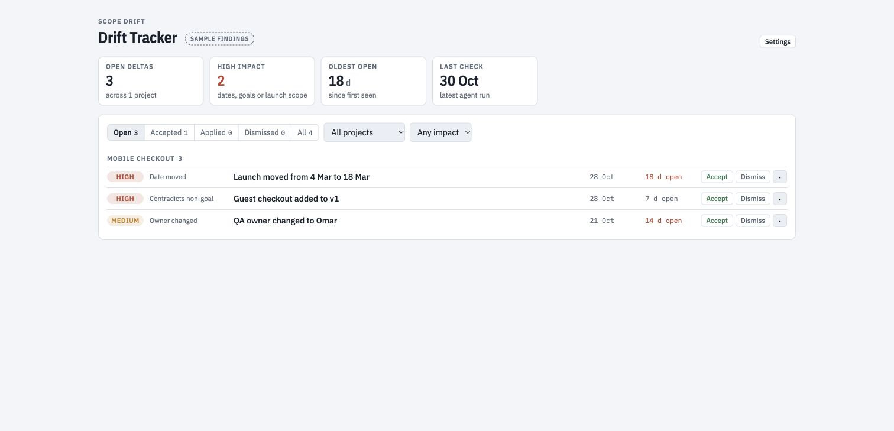

# Drift Tracker

Review differences between agreed project scope and later meeting decisions.

**Status: experimental.** The browser demo shows fictional findings. The connected Notion workflow awaits testing.

## Try the sample

Download this repository and open `index.html` in your browser. Filter findings, expand a row and try a review status. Sample status changes last for the current page session.

The [example scope](examples/scope.md) and [meeting notes](examples/meeting.md) show a simple scope change.

## Set up a connected workflow

1. Give the [scope drift agent](agents/scope-drift-checker.md) your scope, meeting notes and a findings destination.
2. Ask a compatible Claude host to create an artifact from `index.html` with `mcp` access to Notion.
3. In **Settings**, enter the findings database link and connect it.
4. Compare a loaded finding with its source. Confirm the destination before changing a status.

The agent finds differences. The app displays findings and supports review. A connected status change writes to Notion.

## Limitations and testing

- Notion access requires permission and a compatible connector.
- The current adapter expects `notion-fetch`, `notion-query-data-sources` and `notion-update-page` on server `Notion`.
- Each query loads up to 100 findings. Larger databases need pagination support.
- Source links and property values depend on the connector's response format.
- The sample and disconnected state have basic browser checks. Real Notion reads, status updates and agent-to-app flow await testing.

See [testing details](docs/validation.md). Review connected writes using a test database first.

## About this copy

This app comes from PM Toolkit. See [origin and license](ORIGIN.md). Google Fonts loads when internet access is available; system fonts provide a fallback.
